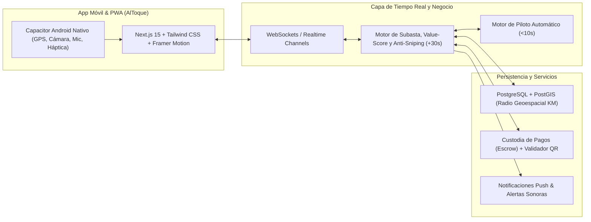

# ⚡ AlToque

> **Subastas inversas locales en tiempo real: tú publicas lo que necesitas, tu barrio compite por atenderte mejor.**


**AlToque** es un marketplace móvil hiperlocal de **subastas inversas en vivo** donde los compradores publican una necesidad inmediata o planificada ("Misión") con ubicación y presupuesto máximo, y los comercios o técnicos verificados dentro del radio geográfico compiten en tiempo real ofreciendo mejores precios o sumando **Cartas de Beneficio** sin sacrificar sus márgenes.

Todo ocurre sobre una experiencia visual **Light-First** cálida, limpia y accesible, guiada por **Toqui** —nuestra mascota capibara oficial— y respaldada por compras grupales (**Modo Vaquita**) y pagos protegidos con liberación mediante **Código QR dinámico**.

---

## 🎨 Identidad Visual y Guía de Estilo (Light-First & High-Retention)

AlToque abandona las interfaces oscuras saturadas y los azules corporativos del retail tradicional en favor de una estética **luminosa, espaciosa, amigable y de alta retención**, inspirada en productos modernos de bienestar y consumo cotidiano.

### Paleta Oficial "Sunset & Violet"

| Token | Código HEX | Rol en la Interfaz (UI) |
| :--- | :---: | :--- |
| **Crema Cálido / Blanco Hueso** | `#FAF9F6` | Fondo principal del lienzo móvil, barra de estado nativa y áreas de respiro visual. |
| **Blanco Puro** | `#FFFFFF` | Superficie elevada de tarjetas principales, modales, burbujas de diálogo y dock flotante. |
| **Violeta Eléctrico** | `#7C3AED` | Color primario de marca, acciones principales (`+ Publicar Misión`), íconos activos y enfoque. |
| **Magenta Orquídea** | `#D946EF` | Acento secundario para degradados Sunset, toggles activos (`Comprador`), chips y microinteracciones. |
| **Naranja Atardecer (Sunset)** | `#F97316` | Bloques de urgencia (`CIERRE EN VIVO`), etiquetas de categoría/velocidad y barras de progreso. |
| **Verde Menta Intenso / Suave** | `#00C853` | Estados positivos, ofertas líderes del podio, ahorro obtenido, bots activos y validación QR/Escrow. |
| **Tinta Violeta Oscuro / Carbón** | `#1E1B4B` | Tipografía principal de alta legibilidad, títulos de misión y precios destacados. |

### Reglas de Componentes y Jerarquía Visual

- **Tarjetas y Squircles (`rounded-2xl` / `rounded-[28px]`):** Bordes ampliamente redondeados con contornos sutiles lavanda (`#EFEAF6`) y sombras difusas cálidas de baja opacidad, eliminando divisiones duras.
- **Pills y Controles Segmentados:** Selector superior en cápsula (`Comprador` | `Proveedor`), etiquetas de contexto en tintes pastel cálidos y botones secundarios contorneados.
- **Tipografía Numérica Tabular (`tabular-nums`):** Uso estricto de `font-variant-numeric: tabular-nums` en todos los relojes regresivos, precios, distancias en kilómetros y porcentajes de recaudación para evitar vibración visual al descontar segundos.
- **Dock de Navegación Flotante:** Barra inferior blanca suspendida con `backdrop-blur` y sombra suave que agrupa los cuatro pilares de navegación: **Podio Vivo**, **Pedir**, **Modo Comercio** y **Cuenta**.

### Mascota Oficial: **Toqui**

**Toqui** es un capibara bípedo, rechoncho y completamente natural (sin ropa, lentes ni accesorios), de pelaje cálido y ojos expresivos y amigables. Su función dentro de la experiencia de usuario es reducir la fricción cognitiva y humanizar la negociación en tiempo real:

1. **Presencia de Marca:** Se asoma de forma orgánica en la cabecera junto al selector de rol.
2. **Guía Contextual en Vivo (`"¡Tip AlToque!"`):** Señala dinámicamente cuántas ofertas están compitiendo en la sala y orienta al comprador para comparar beneficios.
3. **Celebración de Cierres (`"¡Trato hecho!"`):** Acompaña la confirmación del acuerdo y la liberación del pago tras escanear el código QR en el punto de entrega.

---

## 🔄 Flujo de Usuario y Mecánicas Core del Negocio

### 1. Sistema Unificado de Roles (`Comprador` ↔ `Proveedor`)
Con una sola cuenta verificada, cualquier usuario puede alternar instantáneamente entre ambos modos:
- **Modo Comprador:** Crea misiones multimodales (por voz, foto o selección rápida), recibe asesoría del *Asistente de Precio Justo*, organiza compras grupales, evalúa el **Podio Top 3 en vivo** y libera pagos con su código QR único.
- **Modo Proveedor (Comercio o Técnico Local):** Define su ubicación base, ajusta su radio geoespacial de cobertura (`1 km` a `20 km`), controla su interruptor maestro (`En Línea` / `Pausado`), puja en un toque desde el **Radar de Oportunidades** y automatiza respuestas con reglas condicionales.

### 2. Modos de Publicación y Regla Anti-Sniping
- **Modo Relámpago (`5 minutos`):** Diseñado para gastronomía, delivery, farmacia, repuestos o urgencias inmediatas.
- **Modo Programado (`30 a 60 minutos`):** Pensado para servicios técnicos a domicilio (gasfitería, electricidad, mecánica), eventos o encargos planificados.
- **Extensión Anti-Sniping (`+30s`):** Si ingresa una nueva puja o mejora durante los **últimos 10 segundos** del reloj regresivo, el temporizador se extiende automáticamente **+30 segundos**, notificando a todos los participantes para permitir contra-ofertas justas.

### 3. Cartas de Beneficio (*Value-Add Bidding*)
Para proteger la rentabilidad del comercio local y evitar guerras destructivas de precios, el algoritmo del **Podio Top 3** ordena las propuestas mediante un **Puntaje de Valor Compuesto** (ahorro + valor percibido de beneficios + calificación en estrellas + tiempo de llegada). Cada proveedor puede activar hasta **3 Cartas de Beneficio** con un toque:
- `🛵 Envío Gratis` — Despacho o visita técnica sin recargo.
- `⚡ Llego en 20 min` — Compromiso de despacho o atención express.
- `🎁 Producto Extra de Regalo` — Bebida, complemento o insumo adicional de cortesía.
- `🛡️ Garantía 30 Días` — Respaldo directo sobre reparaciones o instalaciones.
- `👑 Atención Prioritaria` — Orden procesada en primer lugar de fila.

### 4. Piloto Automático (*Cero Salas Vacías*)
Los negocios configuran reglas automáticas por categoría, distancia máxima en km, presupuesto mínimo del cliente y franja horaria. Cuando nace una misión compatible, el sistema responde en los primeros `1 a 10 segundos` igualando o descontando un porcentaje definido y adjuntando Cartas de Beneficio predeterminadas.

### 5. Modo Colaborativo ("Vaquita")
Cualquier misión puede habilitarse como **Vaquita Grupal** compartiendo un enlace rápido (`/?pool=<id>`) o un código QR:
- Los invitados ingresan al instante solo con su nombre y avatar (sin formularios extensos).
- Una **barra de meta compartida** refleja en tiempo real los aportes individuales hasta cubrir el presupuesto objetivo.
- Todos los integrantes visualizan el podio sincronizado, lanzan reacciones flotantes (`🔥`, `😍`, `⚡`, `🎁`) y votan su oferta preferida antes de que el anfitrión deslice para confirmar.

### 6. Cumplimiento Seguro con Escrow y Código QR Dinámico
1. **Retención en Garantía (*Escrow*):** Al deslizar para aceptar una oferta ganadora, el monto acordado queda resguardado en custodia para proteger tanto al comprador como al proveedor.
2. **Sala de Ejecución y Chat:** Se habilita un canal directo con envío de fotografías en tiempo real y estados sincronizados (`Preparando` → `En camino` → `En puerta`).
3. **Liberación por QR (`"¡Trato hecho!"`):** Al recibir el pedido o finalizar el servicio, el proveedor escanea el **Código QR dinámico** en la pantalla del comprador. La validación criptográfica marca la orden como completada, libera los fondos inmediatamente al saldo del comercio y despliega la calificación mutua rápida (`1 a 5 estrellas` + etiquetas).

---

## 🏗️ Arquitectura Técnica



### Stack Tecnológico
- **Frontend Móvil y Web:** `Next.js 15` (App Router, exportación estática optimizada), `React 19`, `TypeScript`, `Tailwind CSS` y `Framer Motion` para reordenamiento animado del podio y gestos táctiles (`SlideToAccept`).
- **Empaquetado Nativo Móvil:** `Capacitor Android` con permisos nativos configurados para geolocalización fina (`GPS`), cámara trasera (evidencia y escáner QR), micrófono (dictado multimodal por voz) y retroalimentación háptica (`VIBRATE`).
- **Backend y Sincronización Bidireccional:** Canales `WebSockets / Supabase Realtime` (con soporte híbrido local multi-pestaña vía `BroadcastChannel` para pruebas inmediatas sin configuración previa) que sincronizan temporizadores, pujas, votos grupales, reacciones y chat sin recargar pantalla.
- **Base de Datos Geoespacial:** `PostgreSQL` con extensión `PostGIS` (`GEOGRAPHY(Point, 4326)` e índices `GIST`) para filtrado exacto por radio de cobertura mediante `ST_DWithin` y `ST_Distance`, protegido con políticas **Row Level Security (RLS)**.
- **Pagos con Retención y Seguridad:** Flujo transaccional de **Escrow** con generación de tokens únicos verificables por código QR (`qrcode`) y liquidación atómica en base de datos.

---

## 🗄️ Modelo de Datos Core (Resumen de Entidades)

El esquema relacional completo, triggers y políticas RLS se encuentran implementados en `supabase/migrations/001_init_pide_y_compite.sql`. A continuación se resumen las entidades principales del dominio:

| Entidad | Propósito Principal | Campos Clave |
| :--- | :--- | :--- |
| **`users`** | Cuenta unificada capaz de operar como Comprador o Proveedor, con reputación y billetera. | `id`, `name`, `email`, `phone`, `role_active`, `rating_avg`, `saved_addresses`, `wallet_balance`, `created_at` |
| **`missions`** | Necesidad publicada por el comprador con coordenadas geoespaciales, presupuesto tope y reloj en vivo. | `id`, `buyer_id`, `title`, `description`, `category`, `mode`, `expires_at`, `max_budget`, `lat`, `lng`, `geo_point`, `is_group_pool`, `status` |
| **`bids`** | Pujas en tiempo real emitidas manualmente o por Piloto Automático, ordenadas por puntaje de valor. | `id`, `mission_id`, `provider_id`, `amount`, `benefit_cards[]`, `eta_minutes`, `is_auto_bid`, `value_score`, `created_at` |
| **`benefit_cards`** | Catálogo y metadatos de beneficios de valor agregado (máx. 3 activables por oferta). | `id`, `label`, `emoji`, `score_bonus`, `perceived_value`, `category_scope` |
| **`group_splits`** *(implementado en SQL como `group_pool_members`)* | Participantes invitados a una Vaquita Grupal, sus aportes monetarios y su voto en vivo. | `id`, `mission_id`, `guest_name`, `avatar_emoji`, `contribution_amount`, `voted_bid_id`, `created_at` |
| **`transactions_qr`** *(implementado en SQL como `orders`)* | Custodia Escrow del trato adjudicado, estado logístico y token criptográfico para cierre por QR. | `id`, `mission_id`, `winning_bid_id`, `buyer_id`, `provider_id`, `escrow_amount`, `qr_token`, `fulfillment_status`, `completed_at` |

> **Entidades complementarias en el esquema SQL:** `provider_profiles` (radio en km, categorías, saldo y estado en línea), `auto_bid_rules` (reglas condicionales del Piloto Automático), `messages` (chat en vivo con fotos) y `reviews` (calificación mutua de 1 a 5 estrellas).

---

## 🗺️ Hoja de Ruta (Roadmap MVP)

- **Fase 1 — Prototipo Interactivo & Core Loop en Tiempo Real (Completado ✅)**
  - Sistema visual Light-First **AlToque** (`Sunset & Violet`) con guía interactiva de **Toqui**.
  - Creación multimodal de misiones (voz, cámara y asistente de precio justo).
  - Arena en vivo con Podio Top 3 animado, Cartas de Beneficio, regla anti-sniping (`+30s`), Vaquita Grupal y 5 comercios locales simulados.
  - Empaquetado nativo Android (`APK`) probado en dispositivo físico.
- **Fase 2 — Persistencia Cloud, Auth y Pasarela Escrow Real**
  - Conexión productiva con `Supabase Auth` (OTP telefónico y acceso social) y `Supabase Realtime` multi-dispositivo.
  - Integración con pasarela de pagos local con captura diferida (*pre-authorization / split-payment escrow*) para retención real de fondos y dispersión automática al comercio tras validar el QR.
- **Fase 3 — Piloto Hiperlocal de Barrio (Beta Cerrada)**
  - Onboarding asistido de los primeros 50 comercios gastronómicos, farmacias de barrio y técnicos certificados en un polígono denso de lanzamiento (`3 km` de radio).
  - Notificaciones push nativas (`FCM / APNs`) segmentadas por geocerca y categoría con alertas sonoras diferenciadas.
- **Fase 4 — Escalamiento, Reputación Verificada y Analítica Comercial**
  - Verificación documental automatizada (`KYC / KYB`) para proveedores técnicos.
  - Recomendaciones inteligentes de **Toqui** basadas en horarios pico, conversión histórica por barrio y sugerencia óptima de Cartas de Beneficio.

---

## 🚀 Ejecución Local y Compilación Móvil

### Desarrollo Web / PWA
```bash
npm install
npm run dev
```
Abre `http://localhost:3000` en tu navegador (puedes abrir múltiples pestañas para probar la sincronización instantánea entre Comprador, invitados de la Vaquita y Proveedor).

### Exportación y Sincronización Android (Capacitor)
```bash
npm run build
npx cap sync android
```
El proyecto nativo Android se encuentra en `./android` listo para compilar con Gradle (`./gradlew assembleDebug`) o ejecutar directamente mediante `adb install`.
